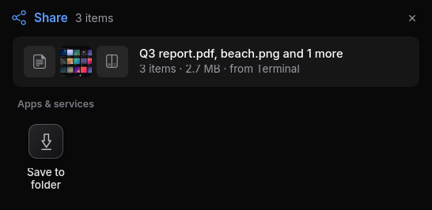
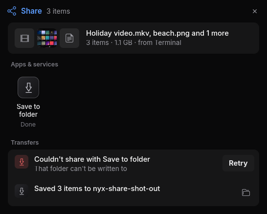
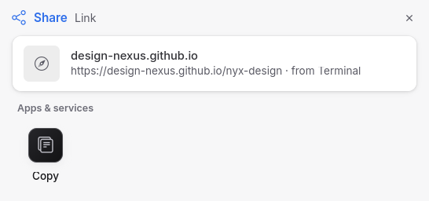
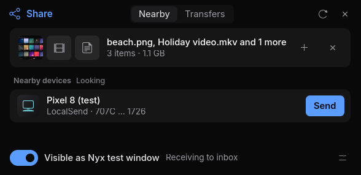
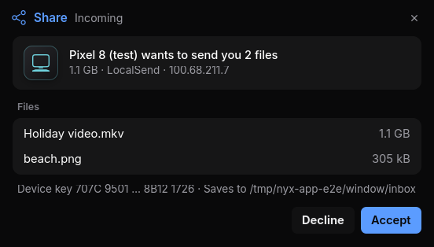
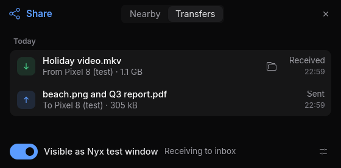
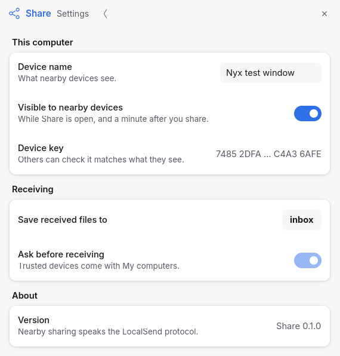

# Share

One Share Sheet for the Nyx suite and any Linux app: send files, images, text and
links to destinations without each app building its own sharing. Nyx Share is a
session D-Bus service (`io.github.design_nexus.nyx.Share1`), a GTK 4 Share Sheet
in Nyx Design 2.0, a command-line tool and a Rust client library. It needs no
cloud service, account or relay.



## What works in this release

| Destination | Takes | Notes |
| --- | --- | --- |
| Copy (clipboard) | One text, link or image | Through `wl-copy`; the content stays on the clipboard after the service exits. |
| Save to folder | Any number of files, images and texts | Copies into a folder you pick. Never moves or overwrites: a taken name becomes `name (2).ext`. |
| Nearby devices | Files, images, text and links | Phones, tablets and computers running LocalSend on your network, over encrypted connections pinned to each device's key. |
| My computers | Files, images, text and links | Computers you saved, reached over the LAN or Tailscale (LAN first), known by their device key rather than their address. Ones you trust can send to you without asking. |
| Phones in Flux | Files, images, text and links | Phones and tablets paired in [Flux](https://github.com/bjarneo/flux); files for an offline phone wait in Flux. See [FLUX.md](docs/FLUX.md). |
| QR code | One text or link | Shown in the Share Sheet, to scan with a phone; Copy image and Save image. |
| Mail, Notes | Text and links; Mail also files | A new message in Nyx Mail for you to address and send, or a new note Nyx Notes shows for you to accept. |
| Cloud accounts | Files, images and text | Copied into a Nyx Cloud account's folder; it uploads in the background. |
| Telegram | Text and links | Your recent chats in Nyx Pulse, while Pulse is open. Sends at once. |
| Bluetooth | Files, images and text | Paired devices that take files (Object Push), with `bluez-obex` installed. |
| Extensions | As each declares | Third-party providers, each run in a sandbox with only what you share; see [PROVIDERS.md](docs/PROVIDERS.md). |
| NAS folders | Files, images and text | A folder on an SMB, SFTP or NFS share, through GVfs like Nyx Files. Copies only; passwords stay in your keyring. See [NAS.md](docs/NAS.md). |

While the service runs (when you share, and for a minute after), this computer
is visible to nearby LocalSend devices and can receive from them. Every
incoming offer asks you first, in the Share Sheet; accepted files go to your
Downloads folder. See [LOCALSEND.md](docs/LOCALSEND.md).

Transfers run in the service, so closing the Share Sheet doesn't stop them, and
the service notifies you when one finishes after the sheet has closed. Phones
through SMS and Nyx Assistant are planned; see
[the roadmap](docs/ROADMAP.md). Nothing in the sheet appears for a destination
that doesn't exist yet.




## The Share app

**Share** in the launcher is a small floating window for nearby sharing, in
place of the LocalSend app: drop files in (or choose files or text), then press
**Send** beside a phone or computer. **Transfers** lists what you sent and
received, kept across restarts. The switch at the bottom says whether this
computer is visible to nearby devices; while the window is open it stays
visible and can receive. Offers that arrive while it's open ask in a dialog
over the window. Settings (the sliders button) has the name others see, the
receive folder, this device's key, **My computers** (trust, remove, add by
address; the pin beside a nearby device saves it too) and **NAS folders** (add,
test, remove). Ctrl+, opens them, F5 looks for devices again, Esc closes.






Settings → Sharing in Nyx Settings has the same settings, plus which
destinations the Share Sheet offers, pinned, hidden and in what order.

## Install

```sh
curl -fsSL https://raw.githubusercontent.com/design-nexus/nyx-share/main/install.sh | bash
```

From a checkout: `./install.sh`. It installs `nyx-share`, `nyx-share-daemon` and
`nyx-share-sheet` to `~/.local/bin`, the D-Bus activation file, a systemd user
unit, the icon, the launcher entry for the Share app and the Nyx Files provider.
Nothing starts until you share or open Share.
`./uninstall.sh` removes them (`--purge` also removes Share's settings, saved
computers and NAS folders, and the NAS passwords in your keyring).

Requires Rust 1.99, GTK 4.18, a session bus and, for the clipboard, `wl-clipboard`.

## Use

```sh
nyx-share ~/Pictures/photo.jpg                 # open the Share Sheet
nyx-share --text "Hello" --url https://example.com
nyx-share --to clipboard --url https://example.com
nyx-share --to save --folder ~/Backups ~/Documents/report.pdf
nyx-share destinations                          # what is available
nyx-share jobs                                  # transfers since the service started
nyx-share cancel JOB
nyx-share computers add 100.101.102.103         # save a computer (address or nearby device)
nyx-share computers trust "G16 Laptop"          # receive from it without asking
nyx-share --device "G16 Laptop" ~/report.pdf
echo "$PASSWORD" | nyx-share nas add "NAS Documents" smb://nas.local/Documents/Inbox --user ken --password-stdin
nyx-share nas test "NAS Documents"
nyx-share --nas "NAS Documents" --subfolder Reports/2026 ~/report.pdf
```

`--to` waits and prints the result (exit status 1 if it fails); add `--no-wait`
to print the job id and return. In the sheet, arrow keys move between
destinations, Enter shares, the context menu (right-click, Menu or Shift+F10)
pins, hides and reorders, Ctrl+←/→ moves the focused destination, and Esc closes.

## In Nyx Files

The installer registers a Nyx Files provider. After you reopen Files, a file's
context menu has **Share…** (the Share Sheet for the selection) and, when a
destination can take the selection without asking anything, **Send to… → Share →**
that destination: your saved computers, NAS folders, nearby devices, and **Copy**
for a single image. A send that is still running after a few seconds continues
in the background and notifies when it finishes. Folders aren't offered yet. The registration is `~/.config/nyx-files/providers/nyx-share/`; delete it,
or add an empty `disabled` file beside it, to turn this off.

## For app developers

Apps call the service over D-Bus, with files passed as read-only file
descriptors, so sandboxed apps work and nothing links to Nyx UI libraries. Rust
apps can use `nyx-share-client`:

```rust
use nyx_share_client::{Client, Content, ShareOptions};
let mut content = Content::new();
content.file("/home/me/Pictures/photo.jpg")?;
Client::connect()?.share(&content, &ShareOptions { app_name: Some("Photos".into()), ..Default::default() })?;
```

See [API.md](docs/API.md) for the interface, [ARCHITECTURE.md](docs/ARCHITECTURE.md),
[PROVIDERS.md](docs/PROVIDERS.md) and [SECURITY.md](docs/SECURITY.md). The Phase 0
integration audit is [docs/AUDIT.md](docs/AUDIT.md).

## Configuration

The service keeps your arrangement (order, pinned and hidden destinations) in
`~/.config/nyx-share/destinations.toml`; change it from the sheet's context menu
or over D-Bus. The sheet remembers the last Save to folder location in
`~/.config/nyx-share/settings.toml`. Nearby sharing reads
`~/.config/nyx-share/nearby.toml` (visibility, the name others see, the receive
folder), which the Share app's settings change; see [LOCALSEND.md](docs/LOCALSEND.md).
Saved computers are in `~/.config/nyx-share/computers.toml` and NAS folders in
`~/.config/nyx-share/nas.toml` (no passwords; see [NAS.md](docs/NAS.md)).
Finished transfers are listed from `~/.local/state/nyx-share/history.json`.

## Build and test

```sh
cargo build --workspace
cargo test -p nyx-share-core -p nyx-share-providers -p nyx-share-client
cargo build -p nyx-share-daemon && dbus-run-session -- cargo test -p nyx-share-client --test service -- --ignored --test-threads=1
```

The service check runs the real daemon on a private bus with scratch directories.

## License

MIT
