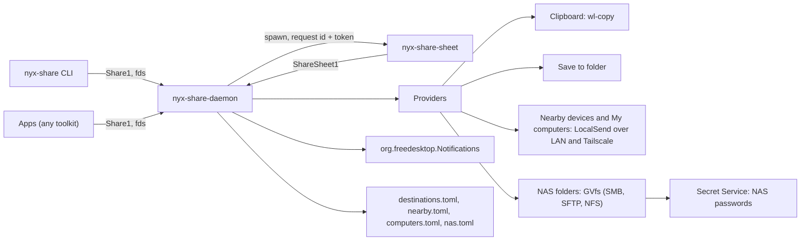

# Architecture

## Pieces

| Crate / app | Role |
| --- | --- |
| `nyx-share-core` | Types and checks with no I/O: `ItemSpec`/`ItemInfo`, `Destination`, `Job`, request validation, filename sanitizing and conflict names, sizes, a small MIME table. |
| `nyx-share-dbus` | Bus name, object path, zbus proxies for `Share1` and `ShareSheet1`, and the JSON wire types. |
| `nyx-share-client` | The public blocking client: opens files read-only and sends descriptors, waits on jobs, streams events. zbus with its default async-io runtime; no GTK, no tokio. |
| `nyx-share-providers` | The `Provider` trait and the built-in destinations. |
| `nyx-share-localsend` | LocalSend v2: identity, TLS, discovery, Tailscale peers, sender, receiver, and the Nearby and My computers providers. |
| `nyx-share-nas` | NAS folders: GVfs mounting with saved credentials, copying with partial files, and the Secret Service store for their passwords. |
| `apps/daemon` | `nyx-share-daemon`: owns requests, jobs, providers and the destination arrangement. |
| `apps/share-sheet` | `nyx-share-sheet`: the Share app window (launcher), the Share Sheet and the incoming-offer prompt, in one GTK application. Stateless; everything comes from the service. |
| `apps/cli` | `nyx-share`. |

## Decisions

- **One public interface, one private.** `Share1` is the stable API for any app.
  `ShareSheet1` (same object) exists only so the sheet can read a request and
  choose a destination; every call needs the request's random token.
- **Files travel as descriptors.** The caller opens each file and passes the
  descriptor; the service never needs the caller's paths, which is what makes
  sandboxed apps work. The daemon checks each descriptor is a regular file
  opened read-only and reads it with positional reads only, because the sheet's
  preview may share the open file description.
- **JSON for structured values**, like `Cloud1` and `Transfer1`: easy from any
  language; unknown fields are ignored for forward compatibility.
- **The service owns transfers.** Jobs run on worker threads in the daemon, so
  the sheet can close. Progress goes out as `JobChanged` signals, at most five a
  second per job. Notifications are sent only for jobs nobody is watching: a
  job started from the sheet notifies once its sheet has closed.
- **On demand.** D-Bus activation starts the daemon; it releases its name and
  exits after 60 s with no jobs, open sheets or calls. It wakes every 15 s
  while running to check that, and not at all otherwise.
- **Programs that must outlive the service** (the sheet, `wl-copy` holding the
  clipboard) are started in their own systemd scope (`systemd-run --user
  --scope`) when the service runs under systemd, so the unit's idle exit doesn't
  take them down.
- **No zbus runtime conflicts.** The daemon uses zbus with async-io and plain
  threads, the same runtime the client needs to stay linkable into nyx-files.
- **The daemon doesn't link nyx-core**, whose default `gtk` feature would be
  unified into the daemon in a workspace build.
- **NAS folders go through GVfs**, not nyx-transferd: no changes to another
  service's API, SMB without an rclone remote, and the same connections as Nyx
  Files. GIO calls run on the job's worker thread with their own main context.
- **The sheet doesn't float by rule.** It is a fixed-size window, which Hyprland
  floats and centres on its own.

## Request flow

1. An app calls `Share(items, fds, options)`. The daemon identifies the caller
   (same user; sandboxed or not), validates items and descriptors, stores a
   request with a random token and starts `nyx-share-sheet` with the id and
   token in its environment.
2. The sheet calls `GetRequest`, shows the preview (image thumbnails through
   `OpenItem`) and the compatible destinations, arranged by the user's
   preferences.
3. Choosing a destination calls `Choose`; Save to folder first asks for a folder
   through the GTK file dialog (the portal, so Nyx Files' picker).
4. The daemon runs the provider on a worker thread and signals progress; the
   sheet follows `JobChanged`. Closing the sheet calls `Dismiss`.

`ShareTo` skips the sheet: the daemon starts the job directly.
